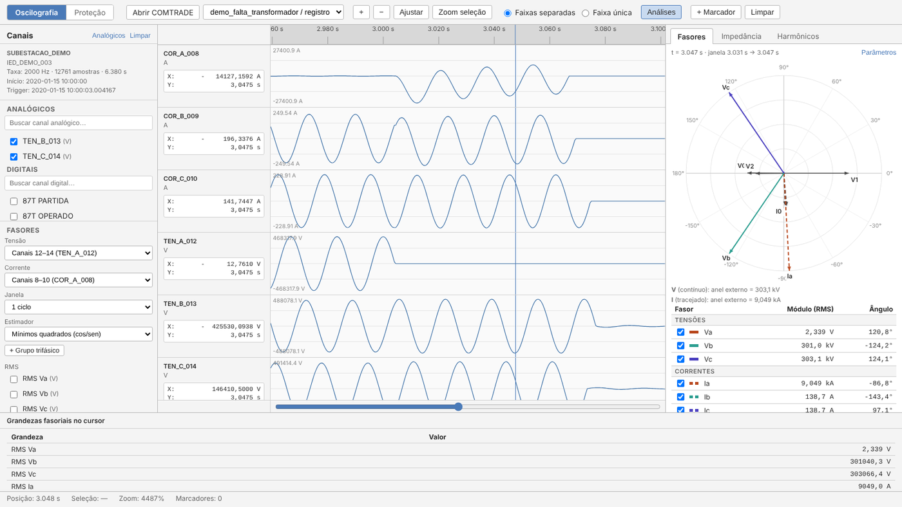
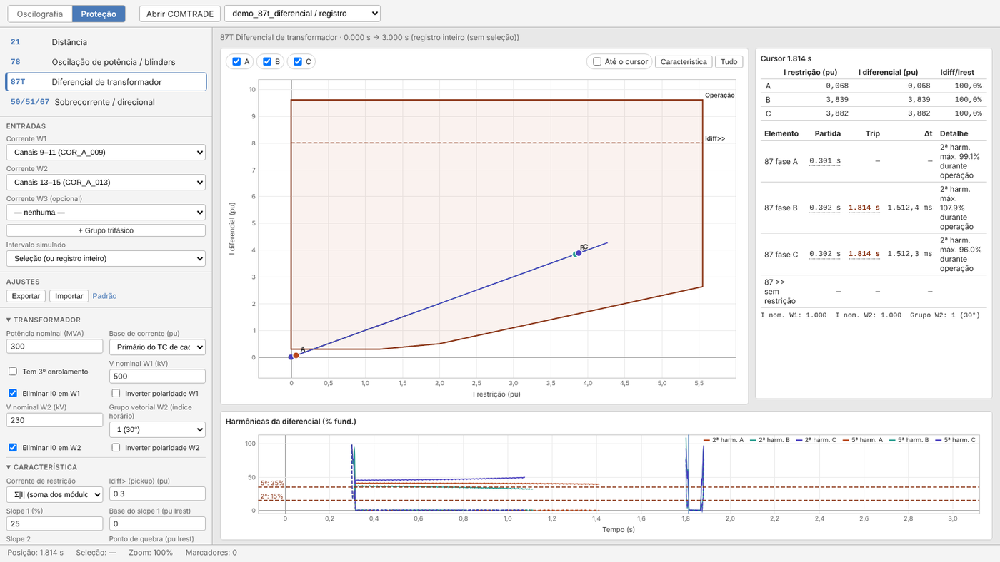
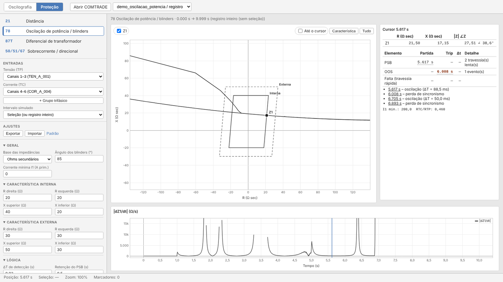

# Oscilo

**Análise de oscilografias COMTRADE de perturbações em sistemas de transmissão.**
Visualização, fasores, impedância, harmônicos e simulação de funções de proteção, no computador ou no navegador.

## Download

Todas as versões estão na página de **[Releases](https://github.com/angelommaia/oscilografias-comtrade/releases/latest)**:

| Versão | Arquivo | Como usar |
|---|---|---|
| **Instalador** (Windows) | `Oscilo_x.y.z_x64-setup.exe` | Execute. Instala só para o usuário, sem precisar de administrador. |
| **Portátil** (Windows) | `Oscilo_x.y.z_x64-portable.zip` | Extraia em qualquer pasta, inclusive num pendrive, e abra `Oscilo.exe`. |
| **Web** (navegador) | `Oscilo_x.y.z_web.zip` | Requer Python 3.10+. Execute `iniciar.bat` (Windows) ou `./iniciar.sh` (Linux/macOS). |
| Linux / macOS | `.AppImage`, `.deb`, `.dmg` | AppImage é portátil; o `.dmg` é para Apple Silicon. |

O instalador e a versão portátil não precisam de Python nem de internet, e os arquivos abertos nunca saem do computador.

## Características

- **COMTRADE** (IEEE C37.111, revisões 1991/1999/2013), nos formatos ASCII, BINARY, BINARY32 e FLOAT32, de qualquer fabricante. Registros de **1 GB** abrem em segundos.
- **Visualização** com faixas por canal ou sobrepostas, zoom, régua com cursor sincronizado, marcadores e canais digitais.
- **Grupos trifásicos** reconhecidos automaticamente pelos nomes dos canais ou montados manualmente.
- **Fasores** estimados por mínimos quadrados, exatos mesmo com número fracionário de amostras por ciclo. Também disponíveis: DFT e variantes com rejeição de DC.
- **Painel de análises:**
  - diagrama fasorial com componentes simétricas;
  - plano **R-X** com a trajetória dos 6 laços e compensação k0;
  - **harmônicos** e THD;
  - grandezas no tempo: RMS, P/Q/S e sequências.
- **Modo Proteção** com ajustes livres e convenções de vários fabricantes. Simula partida e trip no tempo e compara o resultado com os canais digitais do registro.

  
  

| Função | O que mostra |
|---|---|
| **21** Distância | Zonas mho/quadrilaterais, direcionalidade, k0 (complexo ou RE/RL–XE/XL), load encroachment |
| **78** Oscilação de potência | Blinders interno/externo, ΔT, bloqueio (PSB), perda de sincronismo (OOS), dZ/dt |
| **87T** Diferencial | Plano Idiff × Irest, slopes, Idiff>>, grupo vetorial, bloqueio por 2ª/5ª harmônica |
| **50/51/67** Sobrecorrente | Curvas IEC/IEEE/US em log-log, tempo definido, direcional de fase e de terra (67N) |

Os ajustes de cada função podem ser exportados e importados em JSON.

O programa já vem com **oscilografias de exemplo sintéticas**: falta interna em transformador, falta externa (corrente passante), energização com inrush e oscilação de potência com perda de sincronismo. Detalhes em [samples/README.md](samples/README.md).

## Documentação

- [Versão desktop e portátil: como funciona e como compilar](docs/desktop.md)
- [Desenvolvimento: executar pelo código, publicar a versão web, arquitetura e API](docs/desenvolvimento.md)

Licença: [GPL v3](LICENSE).
